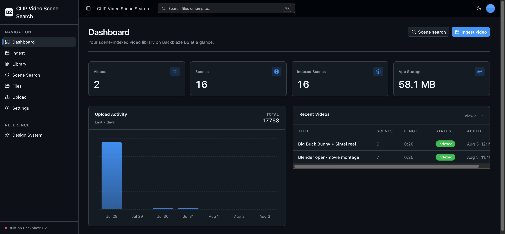
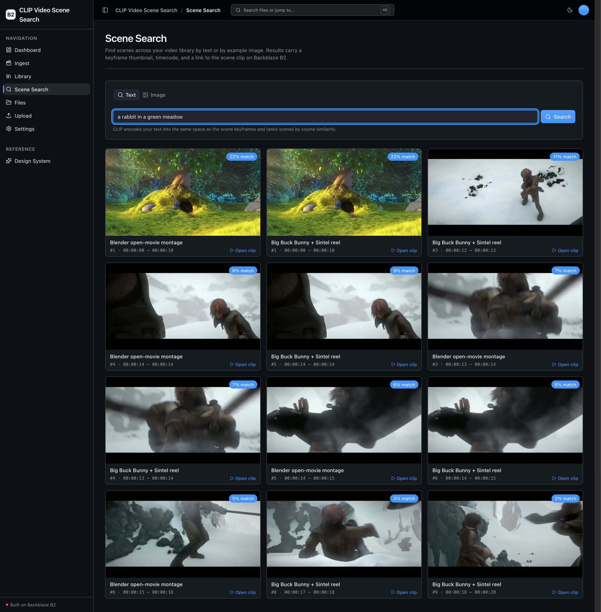
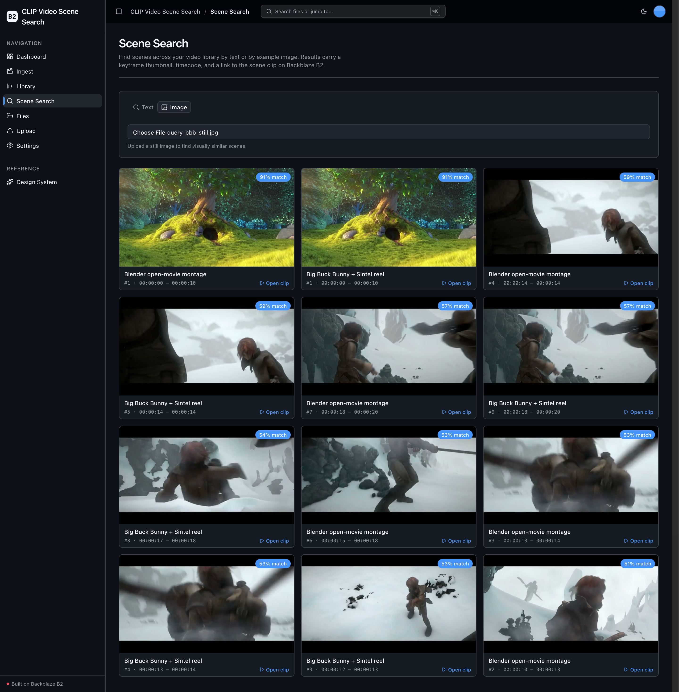
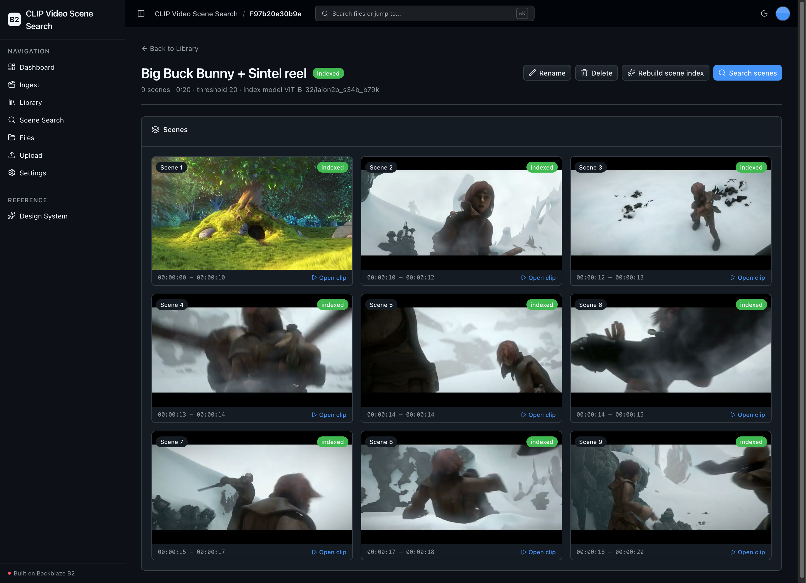
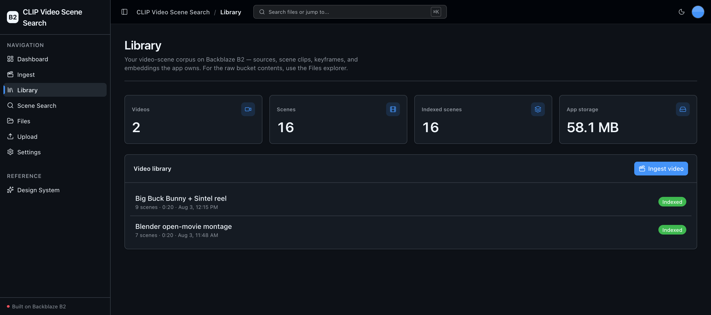
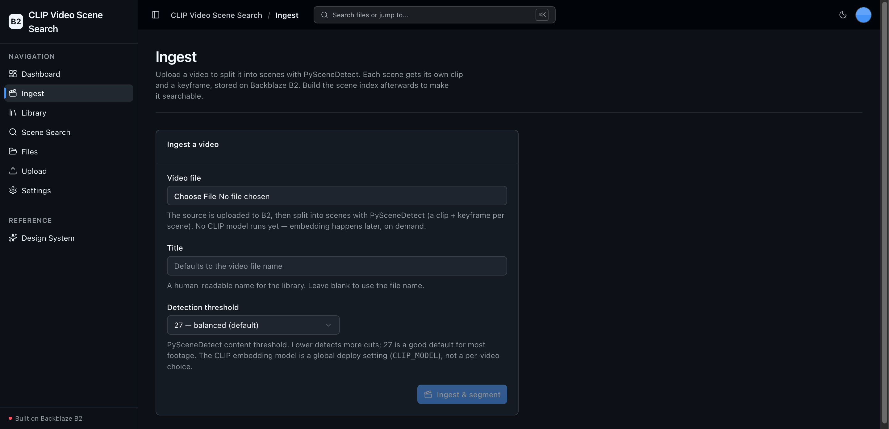

<!-- last_verified: 2026-08-03 -->
# CLIP Video Scene Search

Turn a raw video library on **[Backblaze B2](https://www.backblaze.com/cloud-storage?utm_source=github&utm_medium=referral&utm_campaign=ai_artifacts&utm_content=b2ai-clip-video-scene-search)** into a scene-indexed, visually searchable asset — with no external API dependency. For each source video, [PySceneDetect](https://www.scenedetect.com/) splits it into scenes; per scene the app cuts a scene clip and extracts a representative keyframe with a bundled ffmpeg; [OpenCLIP](https://github.com/mlfoundations/open_clip) embeds each keyframe; and a [FAISS](https://github.com/facebookresearch/faiss) scene index plus JSON metadata are written back to B2. A search UI then answers **text-to-scene** ("a person walking on a beach") and **image-to-scene** (upload a still) queries, returning matching scenes with a keyframe thumbnail, start/end timecode, and a link to the scene clip in B2.

Everything runs on local open-source models — **your B2 credentials are the only secret; there is no second API key.**

**What you get out of the box:**
- Ingest → segment → keyframe → embed → search pipeline, all persisted to B2 via the S3-compatible API
- Text-to-scene and image-to-scene search over a FAISS index
- A sample-scoped **Library** of your videos plus the generic full-bucket **Files** explorer
- Full-stack dashboard UI (Next.js 16 + React 19 + Tailwind v4 + shadcn/ui) and a layered FastAPI backend with structural tests
- CPU-by-default compute with automatic CUDA → Apple MPS → CPU device selection — no GPU required

## What it looks like

**Dashboard** — library metrics (videos, scenes, indexed scenes, and B2 storage), a 7-day activity chart, and a recent-videos table.



**Scene Search (text)** — a natural-language query is encoded by CLIP and ranked against every indexed keyframe; each hit carries a thumbnail, timecode, match score, and a link to the scene clip on B2.



**Scene Search (image)** — upload a still and CLIP returns the visually closest scenes from across the whole library.



**Video detail** — every detected scene of a video as a keyframe grid with per-scene timecodes, index status, and per-clip links.



**Library** — the sample-scoped corpus of ingested videos with scene counts, duration, and index status.



**Ingest** — pick a video, name it, choose a PySceneDetect threshold, and segment it into scenes on B2.



## Why Backblaze B2

This sample demonstrates **sustained multimodal write**: one video fans out into many objects — a source, a clip and keyframe per scene, a per-keyframe embedding, and a global index — so a one-hour video can become hundreds of B2 objects. B2 is the single storage layer for the whole pipeline, accessed only through the S3-compatible API with a custom user agent (`b2ai-clip-video-scene-search`) and the standard `B2_*` environment variables. There is no application database: the meta.json per video, the `.npy` embeddings, and the FAISS index all live in the bucket.

## How it works

```
Ingest (create)                      Build scene index (run)
video ──> PySceneDetect ──> per scene: cut clip + keyframe ──> B2
                                                    │
                                        keyframe ──> OpenCLIP ──> vector (.npy) ──> B2
                                                    │
                                        all vectors ──> FAISS IndexFlatIP ──> index + mapping ──> B2

Search: text / image ──> OpenCLIP ──> cosine over the FAISS index ──> matching scenes
```

The cheap step (segmentation) runs on **create**; the heavy step (CLIP embedding, which downloads the model on first use) is deferred to the **Build scene index** action, so setup stays light.

## B2 object layout

```
videos/<id>/source.<ext>          source video (uploaded or seeded)
videos/<id>/meta.json             video + scene metadata (title, status, scenes[])
scenes/clips/<id>/<n>.mp4         per-scene clips
scenes/keyframes/<id>/<n>.jpg     per-scene keyframes
scenes/embed/<id>/<n>.npy         per-keyframe CLIP vectors
scenes/index/index.faiss          global FAISS scene index
scenes/index/mapping.json         row -> scene mapping for the index
```

## Quick Start

You need: Node.js >= 20, pnpm >= 9, Python >= 3.11, and a free **[Backblaze B2 account](https://www.backblaze.com/cloud-storage?utm_source=github&utm_medium=referral&utm_campaign=ai_artifacts&utm_content=b2ai-clip-video-scene-search)**.

### Supported local environments

Local scripts are supported on macOS, Linux, and WSL2. Native Windows is not supported yet because the dev scripts use POSIX shell syntax and `services/api/.venv/bin/*` paths; use WSL2 on Windows. The first **Build scene index** run downloads the OpenCLIP weights (~600 MB for the default ViT-B-32 model), so a sandboxed environment needs outbound network permission for that step.

### 1. Run setup

```bash
pnpm run setup
```

This copies `.env.example` to `.env` only when `.env` does not already exist, installs workspace dependencies from `pnpm-lock.yaml`, creates `services/api/.venv` if missing, and installs the API's committed Python resolution from `services/api/requirements.lock`. It is safe to rerun and never overwrites an existing `.env`.

> Use the `pnpm run` form: `setup` (like `doctor`) is a built-in pnpm command before pnpm 11, so bare `pnpm setup` would run pnpm's own command instead of this script.

### 2. Add your B2 credentials

Open `.env` and fill in the standard B2 values from the [Backblaze B2 dashboard](https://secure.backblaze.com/b2_buckets.htm?utm_source=github&utm_medium=referral&utm_campaign=ai_artifacts&utm_content=b2ai-clip-video-scene-search). The S3 endpoint is **derived from the region**, so there is no endpoint variable:

| Variable | Where it comes from |
|----------|---------------------|
| `B2_APPLICATION_KEY_ID` | Application key **keyID** (`Read and Write`) |
| `B2_APPLICATION_KEY` | Application key **applicationKey** (shown once) |
| `B2_BUCKET_NAME` | Bucket **Unique Name** |
| `B2_REGION` | The region in the bucket **Endpoint** (e.g. `us-west-004`) |
| `B2_PUBLIC_URL_BASE` | *(optional)* base URL for public object links |

**Optional model/pipeline settings** (defaults are sensible; override via `.env`):

| Variable | Default | What it does |
|----------|---------|--------------|
| `CLIP_MODEL` | `ViT-B-32/laion2b_s34b_b79k` | The OpenCLIP embedding model, as `<arch>/<pretrained>`. This is a single **global** setting, not a per-video choice — every keyframe and query vector must share one dimensionality so they can live in the one shared FAISS index. Changing it after building indexes means rebuilding them. |
| `CLIP_DEVICE` | *(empty = autodetect)* | Force a device (`cuda` / `mps` / `cpu`); empty auto-selects CUDA → Apple MPS → CPU. |
| `SCENE_THRESHOLD` | `27.0` | Default PySceneDetect threshold (the Ingest form can override per video). |
| `SEARCH_TOP_K` | `12` | Default number of scene hits a search returns. |

### 3. Seed a demo video (optional)

```bash
pnpm run seed
```

`scripts/seed_sample_video.py` is fully offline, deterministic, and idempotent: it generates a small synthetic multi-scene clip with the bundled ffmpeg, uploads it, and segments it to status `segmented` (no CLIP model download). Open the Library and click **Build scene index** to embed the keyframes and enable search.

### 4. Run it

```bash
pnpm dev
```

Frontend at `localhost:3000`, API at `localhost:8000`. Ingest a video (or use the seed), build its scene index, then search. Interactive API docs are at `localhost:8000/docs`.

`pnpm dev` runs `pnpm run doctor` first — it catches the common setup gotchas (wrong Node/Python version, missing venv, missing or placeholder `.env`, ports already taken).

## Core Features

- [Scene Detection](docs/features/scene-detection.md) — PySceneDetect `ContentDetector` splits each video into scenes
- [Scene Clips & Keyframes](docs/features/scene-clips-keyframes.md) — per scene, cut a clip and extract a keyframe with the bundled ffmpeg
- [CLIP Embedding](docs/features/clip-embedding.md) — OpenCLIP embeds each keyframe; CPU-default, CUDA/MPS autodetect
- [FAISS Scene Index](docs/features/faiss-scene-index.md) — cosine index + JSON mapping stored in B2
- [Scene Search](docs/features/scene-search.md) — text-to-scene and image-to-scene queries
- [Video Library](docs/features/video-library.md) — sample-scoped library + the generic Files explorer
- [Dashboard](docs/features/dashboard.md) — library metrics and recent videos
- [File Browser](docs/features/file-browser.md) — the generic full-bucket explorer (kept from the starter)
- [Design System](docs/design-system.md) — tokens, primitives, error/empty states. Live at `/design`.

## Tech Stack

- TypeScript, Next.js 16, React 19, Tailwind v4, shadcn/ui, Recharts, TanStack Query
- Python 3.11+, FastAPI, boto3, Pydantic v2
- PySceneDetect, OpenCLIP (open_clip_torch) + PyTorch, FAISS (faiss-cpu), imageio-ffmpeg (bundled ffmpeg)
- Backblaze B2 (S3-compatible object storage)
- pnpm workspaces (monorepo)

## Commands

| Command | What it does |
|---------|-------------|
| `pnpm run setup` | Idempotent cold-start setup (`.env`, workspace deps, backend venv, locked API deps) |
| `pnpm run seed` | Seed a synthetic multi-scene demo video into B2 (offline, idempotent) |
| `pnpm run doctor` | Preflight environment check (also runs before `pnpm dev`) |
| `pnpm dev` | Start frontend + backend |
| `pnpm dev:web` | Frontend only |
| `pnpm dev:api` | Backend only |
| `pnpm contract:export` | Export deterministic FastAPI OpenAPI JSON to `docs/api/openapi.json` |
| `pnpm contract:check` | Verify the checked-in OpenAPI artifact and frontend API client route registry |
| `pnpm check:agent-docs` | Validate agent shims, command docs, CI claims, and `.env` ignore coverage |
| `pnpm verify` | Credential-free non-live pre-PR suite — `check:agent-docs`, `verify:api`, `verify:web` |
| `pnpm verify:api` | Backend half: API lint, API tests, structure tests |
| `pnpm verify:web` | Frontend half: web lint, web unit tests, web typecheck + build |
| `pnpm verify:full` | `pnpm run doctor`, then `pnpm verify`, then Playwright E2E (browser + live prerequisites) |
| `pnpm build` | Build frontend |
| `pnpm lint` | Lint frontend |
| `pnpm lint:api` | Lint backend (ruff) |
| `pnpm test:web` | Run frontend unit tests (vitest) |
| `pnpm test:api` | Run backend tests (pytest) |
| `pnpm check:structure` | Verify layering rules |
| `pnpm test:e2e` | Playwright E2E smoke tests |

Run `pnpm run setup` once before local development. `pnpm verify` needs neither B2 credentials nor a browser and never downloads the CLIP model — the ML stack is lazy-imported, so the backend tests exercise routing and the scene-index logic without pulling weights.

## Documentation Map

| Doc | Purpose |
|-----|---------|
| [AGENTS.md](AGENTS.md) | Agent table of contents — start here |
| [ARCHITECTURE.md](ARCHITECTURE.md) | System layout, layering, data flows, B2 prefixes |
| [docs/features/](docs/features/) | Feature docs (scene detection, clips/keyframes, embedding, index, search, library) |
| [docs/app-workflows.md](docs/app-workflows.md) | User journeys |
| [docs/dev-workflows.md](docs/dev-workflows.md) | Engineering workflows and testing |
| [docs/SECURITY.md](docs/SECURITY.md) | Security principles |
| [docs/RELIABILITY.md](docs/RELIABILITY.md) | Reliability expectations |
| [docs/exec-plans/](docs/exec-plans/) | Execution plans and tech debt tracker |

## License

MIT License - see [LICENSE](LICENSE) for details.
